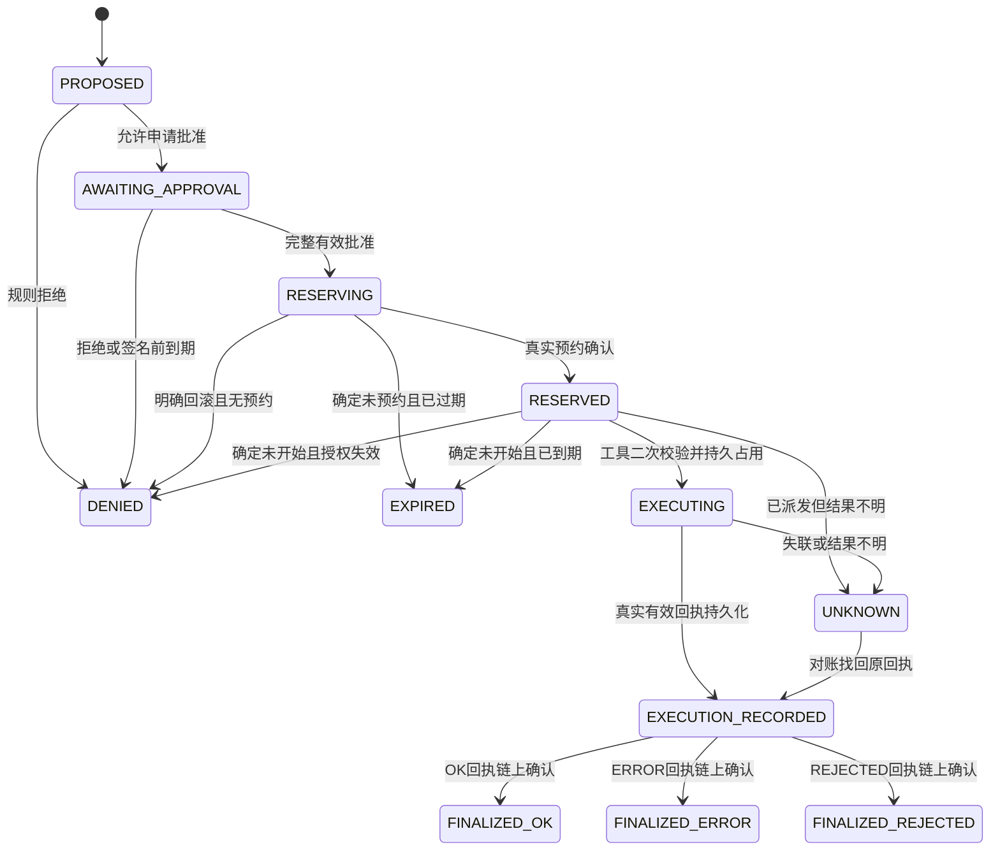

# 状态机与链外一致性

状态：SPECIFIED；状态持久化、真实预约和对账服务 TODO。机器可读的唯一转换清单为 `spec/state-machines.json`；每条边包含 guard。下表逐条解释高风险路径。

| 从 → 到 | 必须满足的事实；后续责任模块 |
|---|---|
| PROPOSED → DENIED | 确定性策略拒绝，未派发；网关 |
| PROPOSED → AWAITING_APPROVAL | R2/R3 基础权限允许申请；网关 |
| AWAITING_APPROVAL → DENIED | 明确拒绝或到期，且未广播预约；批准服务 |
| AWAITING_APPROVAL → RESERVING | 同一意图完整请求者/跨组织签名、当前策略和时效；先持久记录再广播；网关 |
| RESERVING → RESERVED | 自己的可信节点确认成功交易、匹配预约与健康QBFT状态；链客户端 |
| RESERVING → DENIED | 明确revert，且确认 actionId 没有预约；交易超时不满足；链客户端 |
| RESERVING → EXPIRED | 确认没有预约、未派发工具且当前已到期；链客户端 |
| RESERVED → EXECUTING | 工具独立检查链状态、签名人当前撤销状态、策略纪元、TaskGrant、参数/范围、时效；持久唯一占用后才执行；工具 |
| RESERVED → DENIED | 策略撤销或授权失效，且工具持久记录证明未开始；网关/工具 |
| RESERVED → EXPIRED | 达到 expiresAt，且工具持久记录证明未开始；未知记录不能转过期；网关/工具 |
| RESERVED → UNKNOWN | 派发后响应丢失、工具权威状态不可得；网关 |
| EXECUTING → UNKNOWN | 已开始但无法确定实际结果，或没有有效回执；工具/网关 |
| EXECUTING → EXECUTION_RECORDED | 有效 OK/ERROR/REJECTED 工具签名回执已持久保存；工具/审计队列 |
| UNKNOWN → EXECUTION_RECORDED | 查询原 actionId 幂等日志找到原始有效明确结果；禁止再执行；对账 |
| EXECUTION_RECORDED → FINALIZED_OK | outcome=0，AuditRegistry成功确认并匹配事件；审计 |
| EXECUTION_RECORDED → FINALIZED_ERROR | outcome=1，同上；不代表保证零副作用；审计 |
| EXECUTION_RECORDED → FINALIZED_REJECTED | outcome=2，确认工具在产生副作用前拒绝；审计 |

同一状态内的重试不新增执行权：RESERVING RPC不明只查同一actionId；RESERVED断链就等待；EXECUTION_RECORDED仅补交原回执；UNKNOWN仅查日志并对账。终态不能退回执行。到期时间只限制新执行，不限制合法回执晚到。

## 三层状态的准确映射

| 业务 state | 工具持久状态 | 最后确认 chain_state | anchor_status |
|---|---|---|---|
| PROPOSED / AWAITING_APPROVAL | NOT_STARTED | NONE | NOT_APPLICABLE |
| RESERVING | NOT_STARTED | NONE（广播不明保持此值） | PENDING |
| RESERVED | NOT_STARTED，或派发待确认 | RESERVED | PENDING |
| EXECUTING | CLAIMED / RUNNING | RESERVED 或 UNKNOWN | PENDING |
| UNKNOWN | UNKNOWN 或暂不可得 | RESERVED 或 UNKNOWN | PENDING |
| EXECUTION_RECORDED | EXECUTED_OK / EXECUTED_ERROR / REJECTED，原始签名已持久保存 | RESERVED 或 UNKNOWN | PENDING |
| FINALIZED_OK / ERROR / REJECTED | 原始终态不再改变 | 对应 FINALIZED_* | CONFIRMED |
| DENIED / EXPIRED | 权威 NOT_STARTED | NONE 或保留原 RESERVED | NOT_APPLICABLE 或 PENDING；不得声称已最终化 |

`UNANCHORED_EXECUTED` 是派生展示标记：明确已执行回执存在且还没确认上链，不是可重新调度的独立状态。审计页面必须同时显示业务状态和最后确认链状态。链上没有 EXECUTING；本地 EXPIRED 不删除链上预约或释放nonce。

链状态只有：NONE→RESERVED；RESERVED→UNKNOWN（授权对账者提交原因承诺）；RESERVED经finalize或UNKNOWN经reconcile进入三个明确终态。每次改变追加事件；普通网关不能直接改写最终结果。UNKNOWN outcome 的签名只是未知观测，不能finalize为成功或失败。网关本地 UNKNOWN 不要求先有工具签名，也不要求链立刻可达；链不可达时保留其最后确认状态。

## R0/R1 独立读取状态

PROPOSED→DENIED，或权限通过后→READ_EXECUTING；实际结果→READ_OK/READ_ERROR；结果不明→READ_UNKNOWN；找回原始结果后→READ_OK/READ_ERROR。chain_state始终NONE，anchor_status始终NOT_APPLICABLE，intent/ExecutionReceipt/两类链证据均为null。后续签名读日志及批量锚定使用单独记录类型，不调用需要预约的 AuditRegistry.finalize。

## 并发、撤销和未知结果

- 预约：唯一actionId和(requester,nonce)在同一链事务中消费。工具：数据库唯一actionId及完整paramsCommit，先写CLAIMED再做副作用。检查后写入的普通内存锁不足以防重启重放。
- 当前有效授权检查不能被幂等缓存绕过：缓存只可返回已完成原回执，不得为未开始动作提供旧许可。相同actionId不同参数直接拒绝。
- “确认未开始”必须来自认证工具服务的持久日志，并且已经过期或撤销阻止新claim；不能仅依据网关未收到响应、进程内缓存或一次空查询。已有CLAIMED或文件系统崩溃窗口保留UNKNOWN。
- 链预约与链外副作用不具备原子事务。工具执行后审计断链：持久签名回执→待提交队列→恢复后finalize/reconcile，整个过程禁止再发送/再删除。
- 撤销与执行仍存在并发窗口：工具记录核验区块和实际执行时间；核验后发生的撤销不能追溯消除已完成副作用。
